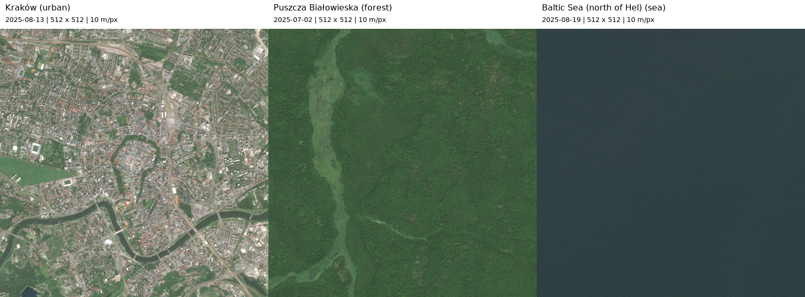

# ML for Space — Sentinel-2 SVD lab

This lab compares SVD reconstruction of three 512 × 512 satellite image crops at
10 m per pixel: urban Kraków, Puszcza Białowieska forest and Baltic Sea water.
It tests the largest singular values, omits the first ten at equal component
counts, and selects ranks using explicit quality criteria and visual inspection.

**Read the [complete report with figures and observations](lab1/results/svd/README.md).**
The [executed notebook](lab1/algebra.ipynb) includes saved outputs. All small
input crops, source metadata, plots and CSV measurements are included locally
for the Git submission; the report can be read without running Python.



## Results

| AOI / terrain | Accepted k | Retained energy | PSNR | SSIM |
| --- | ---: | ---: | ---: | ---: |
| Kraków / urban | 258 | 99.97239% | 41.025 dB | 0.990135 |
| Białowieża / forest | 251 | 99.98440% | 48.064 dB | 0.990112 |
| Baltic / sea | 175 | 99.98210% | 50.066 dB | 0.990106 |

Every integer rank from 1 to 512 was tested. Acceptance requires SSIM ≥ 0.99,
PSNR ≥ 40 dB, and an informal assistant inspection of the full frame and enlarged
detail crop. The selected ranks are the smallest satisfying that lab rule.
Small differences remain in urban edges, canopy texture and subtle water texture;
the report describes them. These are not human detection thresholds or universal
terrain requirements. Acquisition dates and scene conditions differ.

Skipping components 1–10 produced worse PSNR and SSIM at every tested equal-count
comparison, because dominant brightness and spatial patterns were removed.
High retained energy alone also proved misleading: rank-1 Kraków retains about
96% of energy but has SSIM only 0.202. High visual fidelity can require enough
components to remove the storage advantage of a simple SVD factorisation.

## Reproduce

Use Python 3.12 or later and [uv](https://docs.astral.sh/uv/).
From the repository root:

```sh
uv sync --locked
uv run python lab1/run_notebook.py
uv run python lab1/verify_submission.py
```

The SVD experiment reads the included grayscale PNGs and requires no remote
image access or credentials. The notebook can also be opened in a notebook
editor using this project's `.venv` interpreter and run from top to bottom.
Execution recreates results and saves notebook outputs after a successful run.
Local Jupyter execution needs permission to open loopback sockets.

To reproduce image acquisition separately:

```sh
uv run python lab1/prepare_sentinel2.py
```

This verifies and reuses the saved crops by default. `--refresh` queries the
public archive again and requires network access. If refreshed imagery changes,
repeat visual inspection and update `lab1/visual_review.json`; its hashes prevent
silently reusing the previous acceptance notes with different inputs.

## Files and method

- [Lab instructions, AOIs and acquisition details](lab1/README.md)
- [Executed notebook](lab1/algebra.ipynb)
- [Complete report](lab1/results/svd/README.md)
- [Accepted ranks, metrics and visual notes](lab1/results/svd/acceptance_results.csv)
- [All 1,536 dense rank measurements](lab1/results/svd/refined_metrics.csv)
- [Equal-count leading / skip-ten comparisons](lab1/results/svd/skip10_metrics.csv)
- [Source images, metadata and AOI footprints](lab1/data/sentinel2/)
- [Run settings, package versions and input hashes](lab1/results/svd/run_metadata.json)

Analysis uses display grayscale images, uncentered float64 SVD, and unrounded,
unclipped reconstruction metrics. PSNR and SSIM use a common `data_range=255`;
SSIM uses a 7 × 7 uniform window with sample covariance. All grayscale displays
use fixed 0–255 limits. Signed residual and amplified error diagnostics are
labelled separately. Full-rank recovery and the omitted-energy error identities
are verified during execution.

Sentinel-2 Level-2A Collection 1 imagery: Kraków 2025-08-13, Białowieża 2025-07-02,
Baltic 2025-08-19. Contains modified Copernicus Sentinel data 2025, accessed
through [Element 84 Earth Search](https://github.com/Element84/earth-search).
Exact scene identifiers and asset URLs are preserved with each input crop.
