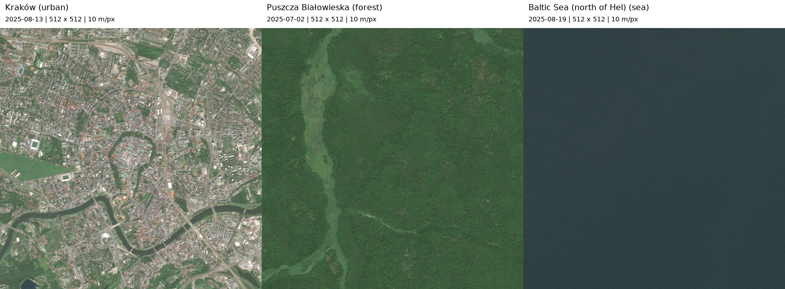

# Sentinel-2 inputs for the SVD lab

The supplied [`algebra.ipynb`](algebra.ipynb) now runs locally and contains saved
outputs for standard grayscale SVD reconstructions of the three approved AOIs.
It displays the originals, ten reconstruction ranks per image, singular-value
decay, retained energy, PSNR and SSIM. All image panels use the same 0–255
brightness limits. The completed experiment also compares skipping the first ten
components at equal counts and evaluates every integer rank to refine acceptance.

## Run the SVD experiment

From the project root, with the downloaded inputs already present:

```sh
uv sync
uv run python lab1/run_notebook.py
uv run python lab1/verify_submission.py
```

Alternatively, select this project's `.venv` Python interpreter in your notebook
editor and run all cells. The notebook supports working directories at the
repository root or `lab1/`. Execution requires no remote image access. The runner
saves the notebook outputs after all cells complete successfully.

See the [results and image grids](results/svd/README.md),
[complete metrics table](results/svd/metrics.csv), and
[quality curves](results/svd/quality_metrics.png).
Tested ranks are 1, 5, 10, 20, 40, 80, 120, 160, 256 and 512.
Metrics use the unrounded, unclipped float64 reconstructions with a fixed
`data_range=255`. SSIM uses a 7 × 7 uniform window and sample covariance.
The run also records input hashes, source scenes, settings and package versions.

The final lab rule combines SSIM ≥ 0.99, PSNR ≥ 40 dB and informal assistant
inspection of full images and enlarged central patches. The selected ranks are
258 (Kraków), 251 (Białowieża) and 175 (Baltic). The previous integer rank narrowly
misses SSIM 0.99 for each crop. Remaining visible differences are documented in
the report and `visual_review.json`; these are operational choices rather than
human perceptual detection thresholds. The review file is bound to the image
hashes and selected ranks so changed inputs require a new review.

At rank 1, Kraków retains 96.04% of energy but has SSIM 0.2020; high energy is
not enough to establish preservation of local detail. The first tested ranks
reaching SSIM 0.95 are 256 for Kraków, 160 for Białowieża and 20 for the Baltic.
These earlier coarse thresholds are retained as baseline results; final
acceptance uses the stricter dense scan and visual review described above.
The notebook checks full-rank recovery, nonincreasing MSE and agreement between
pixel error and discarded squared singular values for all 30 reconstructions.

## Downloaded and verified

| AOI | Acquisition date (UTC) | Flagged local SCL pixels | Local classification |
| --- | --- | --- | --- |
| Kraków | 2025-08-13 | 0.031% | Mixed urban, vegetation and water |
| Puszcza Białowieska | 2025-07-02 | 0% | 100% vegetation |
| Baltic Sea | 2025-08-19 | 0% | 100% water |

All three outputs use EPSG:32634 (UTM zone 34N), with matching dimensions and
pixel spacing. Their RGB previews were visually inspected: city, dense forest
with a small river corridor, and open sea, with no obvious cloud cover.
Grid dimensions, 5.12 km square bounds, reflectance conversion, fixed display
mapping and grayscale dimensions were checked. A second script run verified
all stored per-image hashes and reused the downloads without network requests.

## Areas and matching dimensions

| Input | Centre (longitude, latitude) | Intended terrain |
| --- | --- | --- |
| Kraków | 19.9383, 50.0614 | Urban centre, including the Vistula and parks |
| Puszcza Białowieska | 23.8350, 52.7550 | Forest north of Białowieża village |
| Baltic Sea | 18.8000, 54.8500 | Open water north of Hel |

Each crop is **512 × 512 pixels at native 10 × 10 m pixel spacing**, covering
**5.12 × 5.12 km** in its source UTM projection. The centre is snapped to the
source pixel grid. RGB is not resized or interpolated. Different UTM zones
are retained; reprojecting everything into one zone would add unnecessary
resampling. These are representative square subsets, not administrative or
protected-area boundaries.

## Source and access

Use [Element 84 Earth Search](https://github.com/Element84/earth-search),
collection `sentinel-2-c1-l2a` (Sentinel-2 Level-2A Collection 1). Its COG assets
are public: **no account, API key, secrets file or Earthdata credentials are
needed**. The existing Masters setup uses ASF/Earthdata for Sentinel-1 SAR;
it is not needed here. `.env` files are ignored if private access is added later.

Collection 1 is used because the legacy `sentinel-2-l2a` collection has known
[radiometric offset metadata inconsistencies](https://github.com/Element84/earth-search/issues/71).
Reflectance is computed using each Collection 1 asset's `raster:bands` scale and
offset; both the original digital numbers and floating-point reflectance are saved.

Search dates are **1 June–31 August 2025**, a common summer window with leafy
forest. Each AOI can have a different acquisition date. This is a terrain
comparison, not a simultaneous observation or a controlled terrain-only study.

## Run

From the project root:

```sh
uv sync
uv run python lab1/prepare_sentinel2.py
```

Settings and centres are in `lab1/sentinel2_aois.json`. Existing outputs are
checked against stored SHA-256 hashes and reused when the configuration matches.
Use `--refresh` to search/download again, or `--output PATH` for another dataset.
A refresh may select another scene if the catalogue changes; exact selected
STAC items are preserved in the outputs.

## Selection and quality checks

1. Search all pages for scenes covering each centre within the summer window,
   with at most 10% tile-level cloud cover.
2. Try scenes in ascending tile cloud cover order, using scene ID to break ties.
3. Require the full crop inside a single tile and check all RGB grids match.
4. Check local [Scene Classification Layer (SCL)](https://documentation.dataspace.copernicus.eu/APIs/SentinelHub/Data/S2L2A.html):
   reject crops with more than 0.1% combined nodata, defective pixels, cloud shadow,
   unclassified pixels, cloud, cirrus or snow (classes 0, 1, 3, 7, 8, 9, 10, 11).
5. Reject masked RGB pixels and retain the first passing scene.

SCL has native 20 m spacing and is sampled onto the RGB grid using nearest
neighbour solely for QA. SCL is an automated classification, not a guarantee of
cloud-free pixels or a forest land-cover label. The RGB comparison should also
be inspected visually. SCL vegetation includes land covers other than forest.

All display PNGs use one fixed mapping: reflectance divided by 0.3, clipped to
[0, 1], raised to 1/2.2, then rounded to 8-bit. There is no per-image contrast
stretch. Thus display conversion is consistent; retain the float GeoTIFFs for
any later reflectance-based analysis. Grayscale PNGs use Pillow's RGB-to-L
conversion, matching the starting notebook's grayscale approach.

## Outputs

Under `lab1/data/sentinel2/`:

- `comparison.png`: the three RGB crops with dates and dimensions.
- `aois.geojson`: actual crop footprints for GIS/map inspection.
- For each AOI: `rgb.png`, `grayscale.png`, `rgb_dn.tif`,
  `rgb_reflectance.tif`, `scl.tif`.
- `metadata.json`: acquisition date, CRS, bounds, grid, local SCL fractions,
  conversions, selection attempts, complete configuration and file hashes.
- `source_item.json` and `candidates.json`: selected scene and searched source
  metadata, including original asset URLs.

The HTTP reader requests only required COG byte ranges, splitting large reads
into at most eight concurrent 256 KiB transfers. It validates range headers
and lengths and retries interrupted transfers. Whole Sentinel tiles are not
downloaded.



The small crops, preview and provenance are intended to be included in the Git
submission so results are visible without downloading complete Sentinel tiles.

Attribution: **Contains modified Copernicus Sentinel data 2025**, accessed through
Element 84 Earth Search. The retrieval timestamp is recorded per image.
