# SVD lab: results and observations

Executed notebook: [algebra.ipynb](../../algebra.ipynb). Reproduction instructions: [lab README](../../README.md).

## Accepted ranks for the selected images

Acceptance combines SSIM ≥ 0.99, PSNR ≥ 40 dB and informal visual inspection of the full frame and enlarged central patch at fixed grayscale limits. This is a conservative rule for this lab, not proof of perceptual identity. Every integer rank 1–512 was evaluated; these are the smallest tested ranks passing the joint rule and accepted in the recorded review.

| Terrain / AOI | Accepted k | Energy (%) | PSNR (dB) | SSIM | Previous k SSIM |
| --- | ---: | ---: | ---: | ---: | ---: |
| Kraków (urban) | 258 | 99.97239 | 41.025 | 0.990135 | 0.989934 |
| Puszcza Białowieska (forest) | 251 | 99.98440 | 48.064 | 0.990112 | 0.989955 |
| Baltic Sea (north of Hel) (sea) | 175 | 99.98210 | 50.066 | 0.990106 | 0.989993 |

The previous rank can look almost identical while narrowly missing the numerical threshold. These values are operational choices, not measured human just-noticeable differences.

### Kraków

The Vistula boundary, street layout and larger building patterns are preserved in the full-frame view. The enlarged central patch remains close to the original, so k=258 is accepted under the stated conservative lab rule.

Remaining differences: Slight smoothing and small edge/intensity changes remain on roofs and narrow streets under magnification. Mean absolute error is about 1.80 gray levels; the largest individual error is about 19.92. Rank 257 looks very similar but narrowly misses SSIM 0.99.

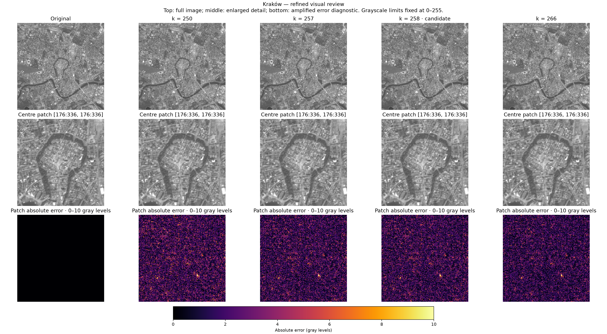

### Puszcza Białowieska

The river corridor and broad canopy patterns are preserved. The central patch retains the fine mottled canopy appearance with only small differences, so k=251 is accepted under the stated lab rule.

Remaining differences: Fine canopy texture is slightly smoothed or altered under magnification. Mean absolute error is about 0.80 gray levels and maximum error about 5.09. Rank 250 narrowly misses the SSIM threshold; its visual difference from 251 is very small.

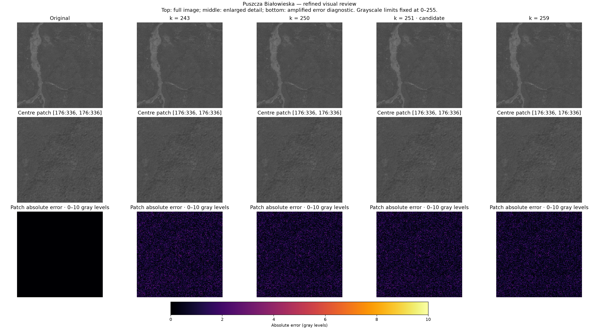

### Baltic Sea (north of Hel)

The full-frame sea crop and enlarged patch look close to the original at the fixed brightness scale. Rank 175 is accepted under the conservative joint rule; much lower ranks can already look plausible because this crop has very little contrast.

Remaining differences: Some subtle texture and noise-like variation is suppressed or altered. Mean absolute error is about 0.64 gray levels and maximum error about 4.20. Rank 174 looks almost the same but narrowly misses SSIM 0.99. This choice is not evidence that 175 components are the human detection threshold.

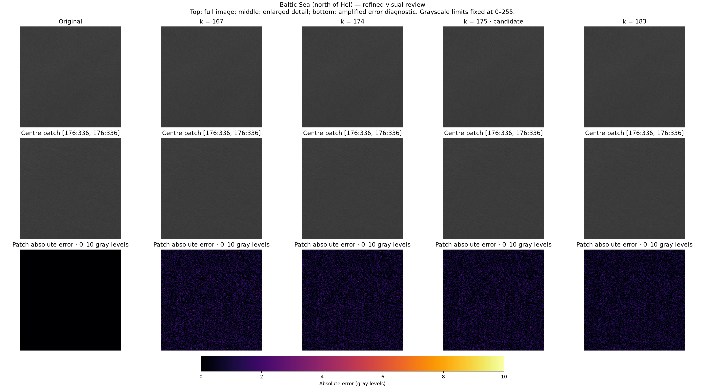

## Does skipping the first ten components help?

No improvement was found in the tested equal-count comparisons. Components 1…k are compared with 11…k+10; both retain exactly k components. The maximum shifted count is 502, because the input has 512 components. The following rows use each terrain's accepted k.

| AOI | k | Leading PSNR | Skip-ten PSNR | Leading SSIM | Skip-ten SSIM | Leading mean gray | Skip-ten mean gray |
| --- | ---: | ---: | ---: | ---: | ---: | ---: | ---: |
| Kraków | 258 | 41.025 | 5.550 | 0.990135 | -0.008459 | 133.427 | -0.00011 |
| Puszcza Białowieska | 251 | 48.064 | 10.013 | 0.990112 | -0.000307 | 80.266 | 0.00001 |
| Baltic Sea (north of Hel) | 175 | 50.066 | 12.596 | 0.990106 | 0.001718 | 59.785 | 0.00000 |

The leading components carry mean brightness and major spatial structures. Removing them leaves small signed contributions near zero. Their fixed-range grayscale display is dark; the diverging diagnostic exposes residual structure but does not restore the missing brightness or structures. Metrics are computed before clipping or rounding.

The leading-k SVD reconstruction minimises squared Frobenius error among rank-k matrices. Skipping large singular values therefore cannot lower MSE or improve PSNR with a fixed data range. SSIM has no such ordering theorem, so its outcome is reported empirically. Even retaining all 502 shifted components cannot recover the omitted leading ten.

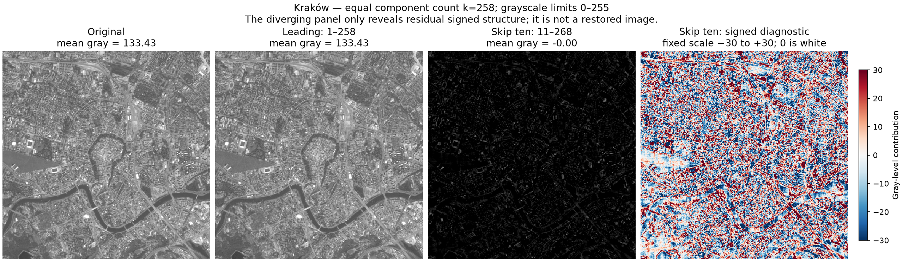

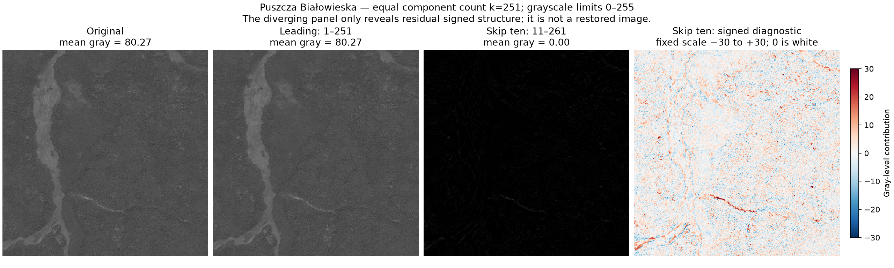

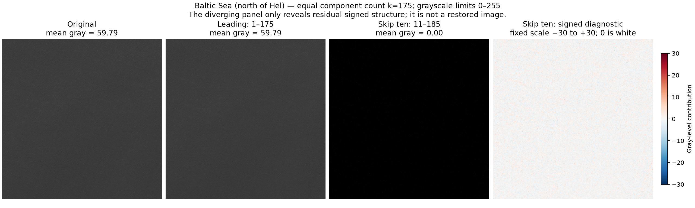

## Energy, quality and storage

At rank 1, Kraków already retains about 96% of uncentered energy while SSIM is only 0.202. Mean brightness dominates energy, especially in the sea image. Energy alone does not establish local-detail preservation. Low sea contrast also makes absolute pixel error small; neither high PSNR nor SSIM should replace image inspection.

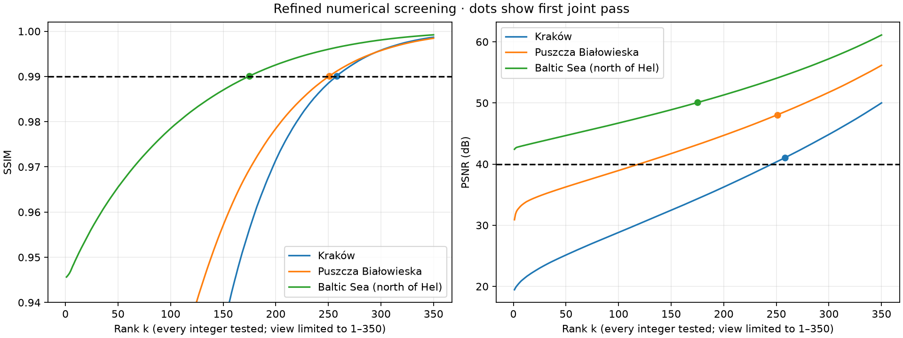

A rank-k factorisation stores k(m+n+1) scalar values. For a 512-square image the scalar break-even point is k < 262144/1025 ≈ 255.75. High fidelity can require enough components to lose even this scalar-count saving. This is not a PNG byte-size comparison: float64 factors use more bytes per scalar than the original uint8 pixels, and real codecs encode them differently.

## Scope and reproducibility

Inputs: Kraków 2025-08-13, Białowieża 2025-07-02, Baltic 2025-08-19; all 512 × 512 at native 10 m spacing. These are three selected crops with different dates, illumination, atmosphere and noise. Results do not establish universal terrain requirements or a formal human perceptual threshold. The experiment uses display grayscale PNGs, not raw reflectance.

Metrics: float64, no centering, rounding or clipping; PSNR data_range=255; SSIM data_range=255, win_size=7, gaussian_weights=False, use_sample_covariance=True. Image displays always use vmin=0, vmax=255, nearest interpolation. Error and signed diagnostics are explicitly labelled and have common fixed scales.

Checks: full-rank recovery within 1e-9 gray levels; nonincreasing leading-rank MSE; agreement of measured MSE with omitted squared singular values for every reconstruction; equal component counts; and shifted MSE never below leading MSE. Input hashes and visual-review hashes are verified before final acceptance.

## Files

- [Acceptance table and review notes](acceptance_results.csv)
- [All 1,536 refined measurements](refined_metrics.csv)
- [All paired leading / skip-ten measurements](skip10_metrics.csv)
- [Initial coarse measurements](metrics.csv)
- [All singular values](singular_values.csv)
- [Run settings, versions and input hashes](run_metadata.json)

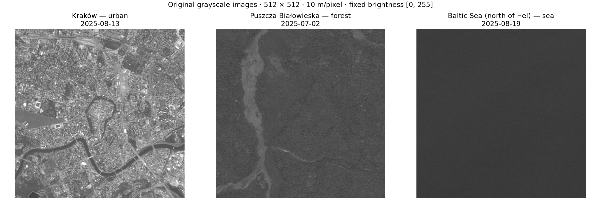
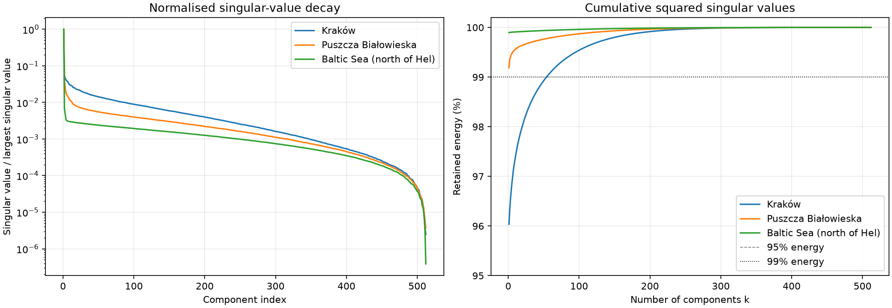

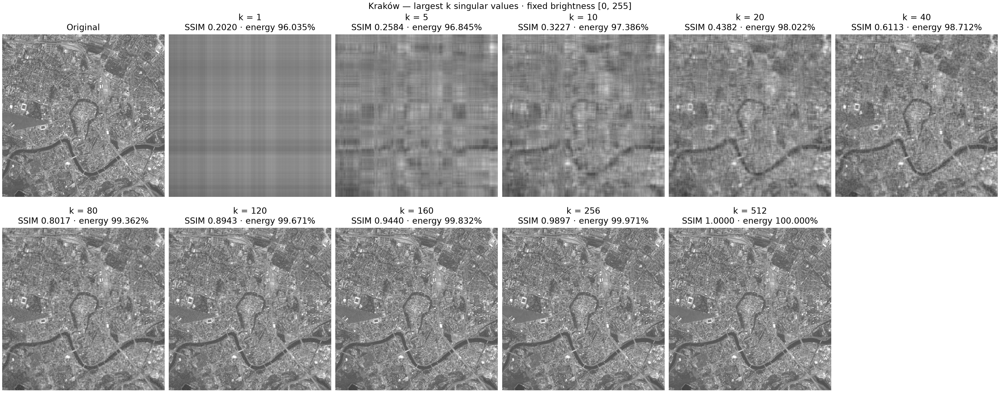

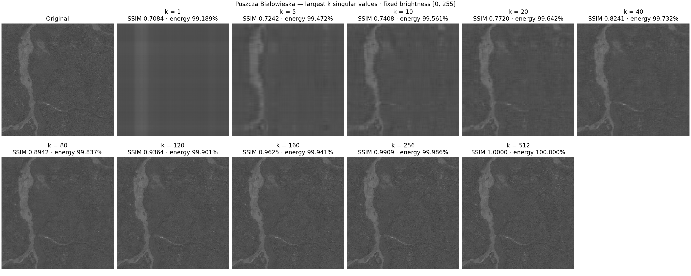

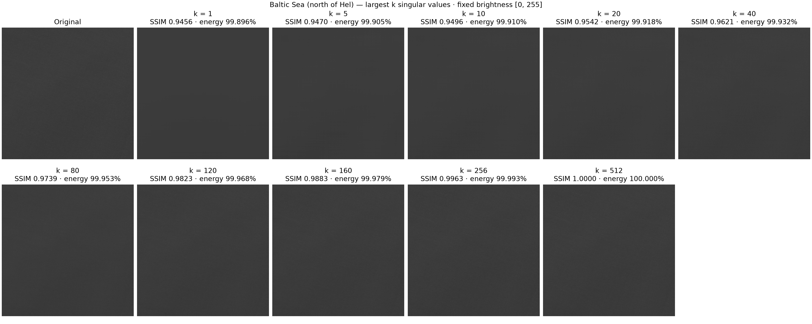

Contains modified Copernicus Sentinel data 2025, accessed through Element 84 Earth Search.
