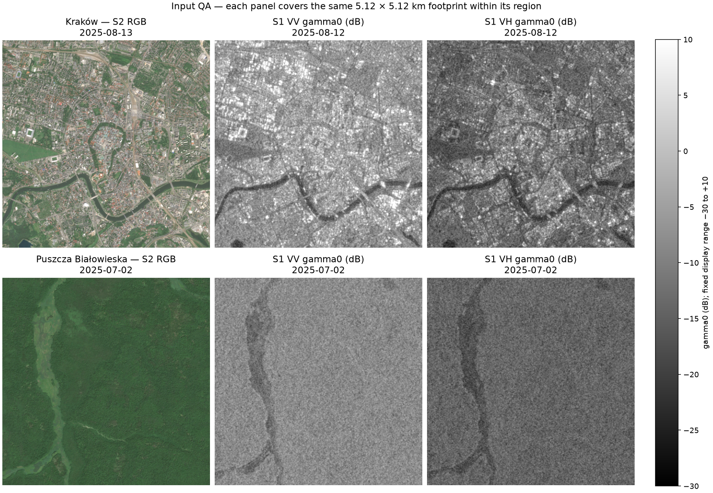

# Lab 2 — distributions, LSB replacement and compressive sensing

Phases 1–5 are complete in [analysis.ipynb](analysis.ipynb). It verifies the
inputs, displays the optical/SAR comparison, and includes normalized histograms
and written observations for both regions and sensors. The two-LSB experiment
includes image comparisons, coarse/fine histograms and answers to all required
visual-quality and detection questions. The optional compressive-sensing exercise
has also been run, with convergence diagnostics and written EO observations.
The supplied [Basic_opt.ipynb](Basic_opt.ipynb) remains the unchanged source reference.

Final verification passed: **17 code cells** in a fresh-kernel Run All, all
**12 scientific figures**, source/result consistency checks and a relocated-copy
offline audit. See [submission review](SUBMISSION_REVIEW.md) for assignment
coverage, audit records and the portable ZIP instructions.

## Selected pair

| Region | Terrain | Sentinel-2 UTC | Sentinel-1 UTC | SAR time offset |
| --- | --- | --- | --- | --- |
| Kraków | Mixed urban, vegetation, river | 2025-08-13 09:46:56 | 2025-08-12 04:53:40 | −28.89 h |
| Puszcza Białowieska | Natural forest and river corridor | 2025-07-02 09:46:14 | 2025-07-02 04:44:19 | −5.03 h |

Each footprint is 5.12 × 5.12 km, with a **512 × 512, EPSG:32634, 10 m spacing**
output grid. Pixel spacing does not imply independent 10 m SAR resolution.
Both SAR scenes are IW descending acquisitions; their relative orbit and full
identifiers are in the manifest. Scenes are chosen independently per region by
nearest UTC time within ±12 days, requiring VV/VH and complete valid coverage.

## Data and method

- **Sentinel-2:** reuse lab 1 B04/B03/B02 (red/green/blue) DN and BOA reflectance
  GeoTIFFs in `../lab1/data/sentinel2/{krakow,bialowieza}/`. Source metadata confirms
  band order. The helper checks input hashes and scale/offset conversions.
- **Sentinel-1:** Planetary Computer's Catalyst RTC product derived from GRD.
  Calibration, terrain normalization with PlanetDEM and UTM orthorectification
  are described in the [collection methodology](https://planetarycomputer.microsoft.com/api/stac/v1/collections/sentinel-1-rtc).
  Crops contain VV/VH **linear gamma0 intensity**, plus `10 * log10(linear)` dB.
  The source `sar:product_type=GRD` field describes the original product;
  the selected collection contains processed RTC assets.
- **Sampling:** read only small source COG windows. Nearest-neighbour sampling
  targets the exact S2 grid. In these two acquisitions, source CRS and 10 m grid
  alignment already match S2, so sampling selects the existing pixel values.
  Source transforms/windows are preserved in metadata. No extra speckle filter
  or radiometric clipping is applied.
- **Optical mask:** common finite/unmasked pixels with positive DN in all three
  bands, excluding SCL 0, 1, 3, 7, 8, 9, 10 and 11. Negative valid reflectance
  and SCL 2 (dark/topographic-shadow areas) are retained. Lab 1 sampled the 20 m
  SCL onto the optical grid with nearest neighbour. Valid counts are 262,064
  for Kraków and 262,144 for Białowieża.
- **SAR mask:** both polarizations finite and positive, respecting source
  nodata. Both crops retain all 262,144 pixels. This is a numeric validity mask,
  not an independent layover/shadow classification. Optical clouds are not used
  to screen SAR. Histograms apply each sensor's own mask.
- **Display:** RGB retains lab 1's common reflectance/gamma mapping. SAR panels
  use a common −30 to +10 dB display range. Only the visualization is clipped;
  GeoTIFFs retain the complete values, including strong urban scatterers.

The comparison was visually inspected: the Vistula bends and the forest river
corridor correspond across the optical and SAR images, with no obvious coverage
gaps. This supports regional correspondence, not a quantitative registration
accuracy claim. The crops mix land covers, and different dates and radar viewing
geometries limit attribution of differences solely to terrain.



## Run and reproduce

From the repository root:

```sh
uv sync --locked
uv run python lab2/inputs.py
```

The second command verifies saved input hashes, grids, valid values and the dB
conversion **offline**. Dependencies, including SciPy for phase 4, are recorded in
`pyproject.toml` and `uv.lock`. Open `lab2/analysis.ipynb` using the project's `.venv` kernel and
run all cells to recreate the preview, verification report, histogram figures,
statistics, LSB experiment and compressive-sensing results. The notebook supports working directories at the repository root or `lab2/`.

To intentionally repeat the catalogue search and acquisition:

```sh
uv run python lab2/inputs.py --refresh
```

This requires network access, may select different scenes if the catalogue
changes, and should be followed by rerunning and inspecting the notebook.
Its acquisition code is also callable directly in the kernel as
`lab_inputs.prepare(refresh=True)`.
The documented Planetary Computer RTC policy says an account is required;
the public signing endpoint supplied working access without a key during this
preparation. Future download access may require an account or changed access
code. Saved local crops and notebook execution do not need tokens or accounts.
Temporary signing tokens are held in memory and omitted from saved provenance.

## Histogram analysis (phase 2)

The notebook plots all six B04/B03/B02 reflectance distributions, with a full-range
view and a central detail view. It also compares VV/VH distributions in both dB
and linear gamma0. Bins are shared across regions and bands within each
representation, and density is computed as count / (valid N × bin width).
All 14 full-range estimates count every valid sample and integrate to one within
1e−12. The central optical view retains full-sample normalization and labels the
fraction outside its displayed range. No radiometric outliers are removed.

Białowieża's optical distributions have narrow low-reflectance peaks; Kraków's
are broader with longer bright tails. Both SAR polarizations also have broader
urban distributions. Linear SAR has strongly right-skewed urban tails, while dB
compresses those extremes. The notebook includes numeric evidence and explains
sensor physics, speckle, masks, dates, viewing geometry and mixed-cover limits.
These are descriptions of two crops, not universal terrain distributions.

Outputs in [results/histograms/](results/histograms/):

- `sentinel2_full_range.png`: six optical histograms with log density axes.
- `sentinel2_central_detail.png`: optical comparison with linear density axes.
- `sentinel1_db.png`: VV/VH comparisons with 0.5 dB bins.
- `sentinel1_linear.png`: VV/VH comparisons using shared log-spaced bins and log axes.
- `summary.csv`: sample counts, ranges, percentiles, moments and density integrals.
- Fourteen per-distribution CSVs: complete bin edges, counts and densities.
- `run_metadata.json`: input hashes, environment versions and exact bin edges.

Run all notebook cells with the project kernel to regenerate these outputs offline.
No histogram findings depend on external downloads.

## Two-LSB replacement (phase 3)

The experiment uses each region's **original uint16 B04 red DN**, preserving
source inputs. It replaces the last two bits of every pixel with independent
uniform values 0–3 using PCG64 seeds 20261109 (Kraków) and 20261110 (Białowieża).
No floating-point quantization or message payload is involved. Statistics and
histograms use the unchanged original optical QA mask; full-frame error metrics
are saved too.

About 75% of valid pixels change, with maximum error **3 DN** and MAE about
**1.25 DN** (0.000125 reflectance). Fixed-map whole images and enlarged details
show no clear loss of visual detail in informal inspection. Signed difference
maps deliberately exaggerate the errors. PSNR is about 92.36 dB using the uint16
container range, with that range dependence explained in the notebook.

Aligned 64-DN histogram counts remain **exactly equal**, because upper bits are
unchanged. Single-DN histograms reveal redistribution within four-level groups:
total variation distance is **0.26681 in Kraków** and **0.05626 in Białowieża**.
Low-bit diagnostics show the original uneven frequencies moving close to 25%
per two-bit value. These controlled comparisons demonstrate a measurable change;
they do not establish a detector for unknown images or prove malicious intent.

Saved under [results/lsb/](results/lsb/):

- `<region>_image_comparison.png`: original/modified full frames and enlarged
  64 × 64 crops, with signed difference maps and common display mapping.
- `histogram_comparison.png`: complete coarse-bin histograms and single-DN
  detail/difference views, all using full valid-sample normalization.
- `bit_and_error_diagnostics.png`: low-two-bit frequencies and signed errors.
- `<region>/B04_original.tif`, `<region>/B04_modified.tif`: lossless uint16
  georeferenced rasters; `<region>/histogram_1dn.csv`: per-level counts/probabilities.
- `metrics.csv`, `two_bit_frequencies.csv`, `histogram_settings.json` and
  `run_metadata.json`: measured errors, histogram differences, seeds, input/output
  hashes and reproduction settings.

The notebook verifies dtype, dimensions, unchanged upper bits, generated lower
bits, bounded errors, lossless readback, preserved georeferencing, normalized
histograms and invariant totals for aligned groups of four and 64 levels.
Run all cells with a fresh project kernel to reproduce the experiment offline.

## Compressive sensing (phase 4)

Section 4 reproduces the supplied signal, 50-of-500 sampling, and all three
optimization formulations with fixed seed **20261109**. The unused `skopt`
import/install is omitted; SciPy is explicitly listed and locked. Computations
run directly in the notebook kernel. The original tutorial remains unchanged.

The supplied L2-only run reports precision loss; L0 and L1 runs hit their default
100-iteration limits. Missing-sample RMSEs are about **1.0120, 1.0123 and 0.8600**,
respectively, compared with **1.0120** for zero filling. The L0 result violates its
constraint. The supplied two-sine signal is not exactly two-sparse in the DCT:
the largest two coefficients retain only **43.54%** of its energy.

A separately labelled **basis-pursuit linear program** fits the same measurements
but still has **0.6660 relative L2 error** and **0.7020 missing-sample RMSE**.
A different, exactly two-sparse DCT positive control is recovered to numerical
precision from the same sample positions. These distinguish optimizer success,
measurement fit and reconstruction accuracy; they do not demonstrate a general
10:1 satellite-image recovery rate.

The notebook discusses potential acquisition/downlink benefits, hyperspectral
coding, sparse EO inverse problems and their limitations, with sources. It
explains why the toy example does not measure instrument savings or validate
recovery of the Sentinel crops.

Outputs in [results/compressive_sensing/](results/compressive_sensing/):

- `signal_sampling_and_dct.png`: supplied signal, measured positions, DCT and energy.
- `reconstruction_comparison.png`: all supplied runs and corrected basis pursuit.
- `exact_sparse_control.png`: separately labelled exactly sparse control.
- `metrics.csv`, `metrics.json`: termination status, warnings, constraint/measurement
  errors, full relative error and missing-sample RMSE; control metrics in JSON.
- `run_metadata.json`, `arrays.npz`: versions, seed, indices, changes/tolerances,
  input signal/mask, reconstructed arrays and control arrays.

Run all notebook cells after `uv sync --locked` to reproduce offline. Expected
solver nonconvergence is reported as an experimental result, not hidden or
mistaken for successful signal recovery. Runtime measurements may vary.

## Final submission (phase 5)

The final notebook section calls [submission.py](submission.py) to check saved
histogram exports against source rasters, LSB outputs/metrics, CS reconstruction
errors, image decoding and local links. It repeats the audit on an isolated
copy with network calls blocked, including importing/loading the relocated
input helper. Results are saved in `results/submission_checks.json`; the
IDE execution/review record is `results/notebook_review.json`.

From the repository root, create the portable archive:

```sh
uv run python lab2/submission.py --package
```

The output is `dist/MLForSpace-lab2-submission.zip`. It includes the available labs, local
inputs/results, code, documentation and dependency files, with CRC and file-hash
verification. The included `SUBMISSION_FILES.sha256` inventory records the exact
contents. The earlier labs are included to retain existing lab 1 provenance links;
the lab 2 analysis uses only the selected urban–natural pair. If `lab3/` is
present, it is included so links in the repository-wide README also resolve
after extraction. Environments,
Git/editor metadata, hidden files and caches are excluded. The root `.gitignore`
is included as a deliberate exception. See [SUBMISSION_REVIEW.md](SUBMISSION_REVIEW.md)
for extraction and reproduction instructions.

## Saved files

- [data/manifest.json](data/manifest.json): scene IDs, timestamps, time offsets,
  band order, units, paths, footprints, grid, masks, calibration and SHA-256 hashes.
- `data/sentinel1/<region>/`: `gamma0_linear.tif`, `gamma0_db.tif`,
  `valid_mask.tif`, selected unsigned `source_item.json`, all queried dual-pol
  `candidates.json`, and crop/selection `metadata.json`.
- `data/sentinel2/<region>/valid_mask.tif`: masks referencing existing lab 1 data.
- [data/verification.json](data/verification.json): environment versions and
  input verification summary, recreated in the notebook.
- [inputs.py](inputs.py): acquisition, local verification and notebook loading.

Keep these small crops and metadata with the submission, alongside the referenced
lab 1 files. Entire multi-gigabyte source scenes are never downloaded or stored.

Contains modified Copernicus Sentinel data 2025. Sentinel-1 processed by Catalyst,
hosted by Microsoft Planetary Computer, collection license **CC BY 4.0**.
Sentinel-2 Level-2A Collection 1 accessed through
[Element 84 Earth Search](https://earth-search.aws.element84.com/v1/collections/sentinel-2-c1-l2a);
see [lab 1 provenance](../lab1/README.md).
