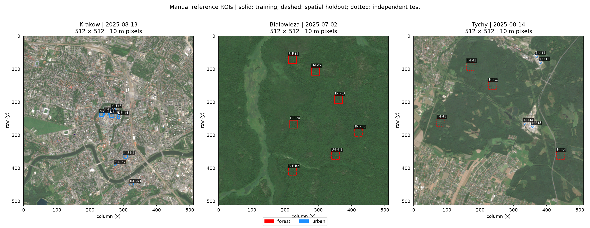
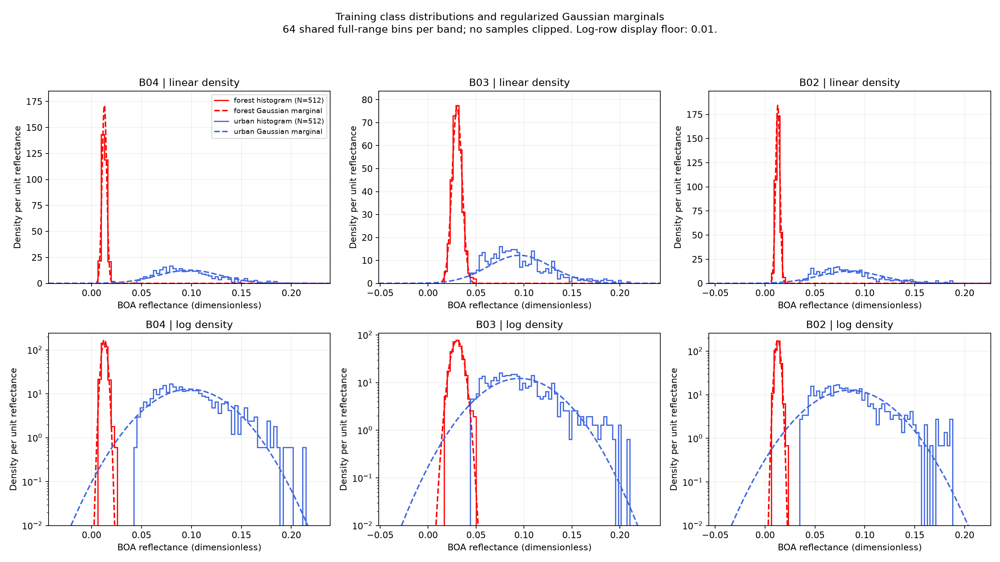
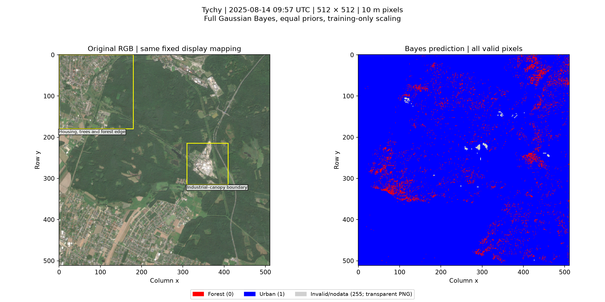
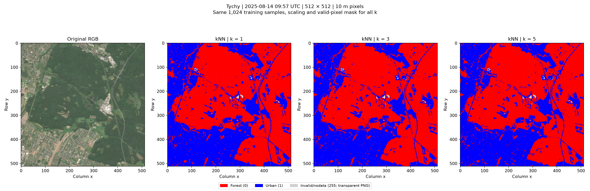
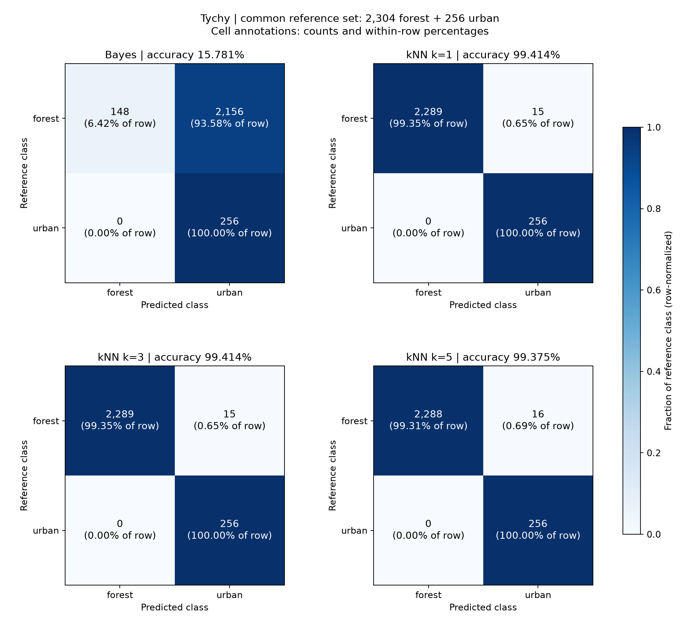

# Lab 3 — Bayes and kNN forest–urban classification

**All six phases are complete** in [analysis.ipynb](analysis.ipynb), with saved outputs.
The notebook verifies the imagery, shows labelled ROIs and enlarged reference
chips, saves reproducible training samples, and fits training-only feature
scaling. It also fits full Gaussian class PDFs, plots their marginals against
training histograms, and applies a scratch Bayes classifier to Tychy. The maps
and reserved references show poor forest transfer (148/2,304 correct forest
pixels); numerical correctness does not imply model accuracy. Scratch kNN maps
for k = 1, 3 and 5 use the same inputs and have much higher agreement on these
sparse references. The common-reference comparison reports all four methods'
confusion matrices, metrics and k effects, with written limits. Final submission
review and packaging (phase 6) are documented below and in the submission review.
See [CHECKLIST.md](CHECKLIST.md) for the completed work and its evidence.

## Inputs and references

| Image | Role | Acquisition UTC | Valid pixels |
| --- | --- | --- | ---: |
| Kraków | Urban training and separate spatial holdout | 2025-08-13 09:46:56 | 262,064 |
| Białowieża | Forest training and separate spatial holdout | 2025-07-02 09:46:14 | 262,144 |
| Tychy forest–urban boundary | Independent mixed test image; no training samples | 2025-08-14 09:57:04 | 261,648 |

All images are **512 × 512 pixels, EPSG:32634, native 10 m spacing**, covering
5.12 × 5.12 km. Features are B04/B03/B02 **dimensionless BOA reflectance** in
that order. Earlier-lab inputs remain unchanged in
`../lab1/data/sentinel2/{krakow,bialowieza}/`. Their hashes, calibration, masks
and grids are verified against original metadata and the Lab 2 manifest.
Lab 2 optical masks are checked for exact equality with recomputed QA.

The new test scene is **S2C_T34UCA_20250814T095058_L2A**, centred on
19.0° E, 50.16° N. Its footprint does not intersect either training footprint,
and its scene ID differs from both training scenes. The geographic scene
footprints, pixel transforms, exact timestamps, asset URLs, source metadata and
per-band calibration are recorded in [data/manifest.json](data/manifest.json)
and [test metadata](data/sentinel2/tychy/metadata.json).

Imagery comes from the public
[Earth Search Sentinel-2 Collection 1 Level-2A catalogue](https://earth-search.aws.element84.com/v1/collections/sentinel-2-c1-l2a),
using the existing [Lab 1 acquisition helper](../lab1/prepare_sentinel2.py).
Only small COG windows are read; no complete tiles or credentials are needed.
Test configuration is [test_aoi.json](test_aoi.json). The August search keeps
tile cloud cover at most 10% and selects the lowest-cloud candidate with full
coverage and local flagged-SCL fraction at most 0.25%. This differs explicitly
from Lab 1's 0.1% local threshold: an initial summer search at 0.1% rejected all
Tychy candidates. Those initial attempts are retained separately; they do not
describe the successful August selection. The selected crop has **496 flagged
pixels (0.1892%)**, all excluded from valid features and labels.

QA excludes SCL 0, 1, 3, 7, 8, 9, 10 and 11, nonpositive source DN, source
nodata and nonfinite reflectance. It retains SCL 2, valid dark pixels and
negative reflectance. SCL is nearest-neighbour sampled from its native 20 m
grid for QA only. It is never used as a forest/urban reference label.
RGB previews share the earlier labs' fixed display conversion: reflectance /
0.3, clipped to [0,1], gamma 1/2.2 and rounded to uint8. This conversion is
verified and never used as the numerical feature transformation.

## Manual labels and split

[rois.json](rois.json) records **23 manually selected rectangular ROIs**,
their class, split, rationale, seed and coordinate convention. Coordinates are
zero-based `[x0, y0, x1, y1]`, with exclusive upper bounds. Labels are visual
interpretations made by the assistant before model fitting, not field-verified
ground truth. Source context and enlarged native-pixel chips were inspected;
obvious courtyard vegetation was rejected/trimmed from initial urban proposals.

- **0, forest, red:** closed-canopy interiors, excluding clearings, river
  corridors, fields and uncertain edges.
- **1, urban, blue:** continuous built-up impervious fabric: roofs, paved
  streets/courtyards and industrial structures. Substantial vegetation, water
  and uncertain edges are excluded from reference areas.
- **255:** unlabelled/uncertain. This is not a third trained class.

Kraków has **648 urban training-ROI pixels** and **252 urban holdout pixels**.
Białowieża has **2,304 forest training-ROI pixels** and **1,728 forest holdout
pixels**. Whole training and holdout ROIs have a checked **16-pixel / 160 m
Chebyshev exclusion buffer**; no random pixel train/test split is used.
Tychy has **2,304 forest and 256 urban reference pixels**, independent of the
training footprints. Its urban references emphasize clear industrial surfaces.
All current reference pixels pass QA. QA and reference masks are separate.



Enlarged chips: [Kraków](data/krakow_roi_chips.png),
[Białowieża](data/bialowieza_roi_chips.png), [Tychy](data/tychy_roi_chips.png).

A PCG64 generator with seed **20261115** selects **512 samples per class
without replacement**, yielding 1,024 training rows shared by both future
classifiers. Sampling identities, raw/scaled features and labels are saved in
`data/training_samples.npz`: `source_id` maps to Kraków = 0, Białowieża = 1;
`flat_index` is the source row-major pixel index. Candidate training ROIs are
larger than the selected training sample. Holdout and test references are not
used for sampling or parameter fitting.

Scaling uses each band's mean and population standard deviation (`ddof=0`)
over exactly these training rows. An exactly zero standard deviation becomes
1. [data/scaling.json](data/scaling.json) saves the parameters; apply
`(X_raw - mean) / scale` unchanged to every image. Both classifiers will use
this same feature representation and training set.

## Phase 2 — training distributions and parametric PDFs

Section 2 uses the exact saved **512 samples per class** from phase 1. Six
training histograms use **64 shared full-range bins per band** and density
`count / (N_class * bin_width)`. Every sample is counted. The comparison has
linear and logarithmic density views; the latter explicitly displays densities
above 0.01. A separate forest detail uses 24 full-range forest bins per band
to reveal its much narrower shape, with separate labelled axes.



The implementation estimates class means and full 3 × 3 maximum-likelihood
covariances directly with NumPy, dividing by **N**, then adds **1e-6 I in
standardized feature units**. Raw-unit means/covariances are obtained by the
exact inverse scaling; both unregularized MLE and regularized parameters are
saved. Priors are **0.5 / 0.5**, a lab comparison assumption rather than an
estimate of Tychy's land-cover proportions. The plotted curves are Gaussian
marginals; the full model retains cross-band covariance.

| Class | Mean B04 | Mean B03 | Mean B02 | MLE std B04 / B03 / B02 |
| --- | ---: | ---: | ---: | --- |
| Forest | 0.012847 | 0.030196 | 0.012755 | 0.002329 / 0.005193 / 0.002163 |
| Urban | 0.097916 | 0.095404 | 0.084926 | 0.031328 / 0.032642 / 0.031380 |

The selected forest samples have a narrow, approximately bell-shaped central
peak, with positive skew and some excess tail weight. Urban samples are brighter,
broader and more right-skewed: the symmetric Gaussian misses some bright-tail
behavior. The shared-bin empirical overlap is 0% / 1.367% / 0% for B04/B03/B02;
this is bin-dependent training evidence, not a classification error estimate.
Band correlations are strong (forest 0.729–0.793, urban 0.765–0.962), supporting
retention of the full covariance. The fixed regularization changes the largest
relative marginal variance by only 0.0425% for forest and 0.000235% for urban.
The notebook discusses covariance sensitivity and the limits of visual labels,
selected interiors, scene differences and an unbounded Gaussian model.

Outputs under `results/bayes/`:

- [gaussian_model.json](results/bayes/gaussian_model.json) and
  `gaussian_model.npz`: full mean/covariance arrays in raw and scaled units,
  priors, scaling and regularization, ready for phase 3.
- [parameters.csv](results/bayes/parameters.csv),
  [covariances.csv](results/bayes/covariances.csv), and
  [summary.csv](results/bayes/summary.csv): full-precision parameter/moment tables.
- Six shared-bin histogram CSVs and three forest-detail CSVs: all bin edges,
  counts, densities and, for the shared bins, fitted marginal density at centres.
- [Forest detail](results/bayes/forest_marginal_detail.png) and
  [band correlations](results/bayes/band_correlations.png), alongside the main
  comparison figure.
- [Regularization sensitivity](results/bayes/regularization_sensitivity.csv),
  [histogram overlap](results/bayes/histogram_overlap.csv),
  [marginal checks](results/bayes/marginal_checks.json), and
  [run metadata](results/bayes/run_metadata.json): diagnostics and input hashes.
- [verification.json](results/bayes/verification.json): nine histogram exports
  checked against training samples, six normalized Gaussian marginals,
  raw/scaled covariance and density conversion checks, a hand-calculated MLE
  example, positive-definite covariance checks and model/table readback.

All **13 code cells** (phases 1–2) passed a fresh-kernel run with saved outputs.
The three phase-2 scientific figures and written observations were reviewed;
see [phase2_review.json](results/bayes/phase2_review.json).

## Phase 3 — scratch Bayes decisions and maps

[bayes.py](bayes.py) implements class means/MLE covariances and full Gaussian
log scores using NumPy. The decision maximizes `log p(z | class) + log prior`
under equal misclassification costs; the common evidence term cancels.
Cholesky factors provide log determinants and quadratic terms through solves,
without matrix inversion or products of marginal PDFs. Exact score ties choose
the smaller class ID (forest = 0). Parameters, regularization, equal priors
and training-only scaling remain fixed from phase 2.

All **261,648 valid Tychy pixels** are classified. The georeferenced uint8
GeoTIFF preserves the original 512 × 512, EPSG:32634, 10 m grid and uses
**0 = forest, 1 = urban, 255 = nodata**. A separate RGBA PNG displays forest
in red, urban in blue and invalid pixels transparently. Plots show nodata
against grey, with dates, legends and matched detail crops.



The map contains **10,487 forest**, **251,161 urban** and **496 nodata** pixels.
Only 4.01% of valid pixels are called forest, despite visually extensive canopy.
The reserved references give:

| Reference class | Predicted forest | Predicted urban | Support |
| --- | ---: | ---: | ---: |
| Forest | 148 | 2,156 | 2,304 |
| Urban | 0 | 256 | 256 |

Forest reference recall is **6.42%**. The perfect agreement on 256 industrial
urban pixels applies only to these sparse, visually labelled interiors.
Both the full map and [detail crops](results/bayes/classification/tychy_bayes_details.png)
show extensive forest assigned urban. The notebook explains shadow/mixed-pixel
uncertainty, trees in urban fabric, forced decisions on other land covers and
the distinction between visual observations and reference-supported errors.

Post-prediction feature summaries show that Tychy's forest has higher mean red
and blue reflectance than the narrowly distributed Białowieża training sample.
The forest PDF penalizes that shift strongly; the broader urban PDF wins.
This supports a transfer problem without identifying its physical causes.
The model and reference ROIs were not retuned after seeing the result.

Files under `results/bayes/classification/` include:

- `tychy_bayes_classes.tif`, `tychy_bayes_colors.png` and
  `tychy_bayes_scores.npz`: class IDs, coloured map and finite valid-pixel
  log scores with row-major pixel indices. Scores are not normalized posteriors.
- Original/prediction and detail figures, plus the
  [reference agreement figure](results/bayes/classification/tychy_bayes_reference_agreement.png).
- [Per-ROI agreement](results/bayes/classification/test_roi_agreement.csv),
  [reference confusion counts](results/bayes/classification/test_reference_confusion.csv)
  and [feature shifts](results/bayes/classification/test_reference_feature_summary.csv).
- [Run metadata](results/bayes/classification/run_metadata.json) and
  [verification](results/bayes/classification/verification.json): input/output
  hashes, finite scores, hand-calculated score/tie/unequal-prior checks,
  independent full-image scoring, batch invariance, raw/scaled decision
  equivalence, and lossless georeferenced raster/PNG/score readback.

All **19 code cells** (phases 1–3) passed a fresh-kernel run with saved outputs.
The three classification figures and written observations were reviewed; see
[phase3_review.json](results/bayes/classification/phase3_review.json).

## Phase 4 — scratch kNN for k = 1, 3 and 5

[knn.py](knn.py) implements exhaustive squared Euclidean distances, stable
neighbour selection and unweighted binary majority voting with NumPy. It uses
the same 1,024 saved standardized training rows and every valid Tychy query
pixel as Bayes. Exact equal distances are ordered by saved training row index;
there is no approximate tie tolerance. All distances use float64 differences,
preventing unsigned integer overflow. The three k values share one neighbour
ranking and fixed training-only scaling.

The calculation processes 512 queries at a time: each distance matrix is
512 × 1,024, or 4 MiB, rather than a roughly 2 GiB full-image matrix. Sorting,
temporary arrays and saved outputs add memory. The six nearest training rows
and squared distances are retained to audit the boundary at all three k values.
Neighbours are selected spectrally, not spatially; increasing k is not an image
smoothing operation.



| k | Forest map pixels | Urban map pixels | Correct forest reference | Correct urban reference |
| --- | ---: | ---: | ---: | ---: |
| 1 | 157,128 | 104,520 | 2,289 / 2,304 | 256 / 256 |
| 3 | 158,625 | 103,023 | 2,289 / 2,304 | 256 / 256 |
| 5 | 157,928 | 103,720 | 2,288 / 2,304 | 256 / 256 |

All three maps preserve **496 nodata pixels**, use forest red / urban blue and
retain the source georeferencing. Forest reference agreement is **99.35%** for
k = 1 and 3, **99.31%** for k = 5. The sparse, manually labelled references
emphasize clear canopy and industrial urban interiors; they are not a full-image
accuracy assessment.

Changing k = 1 → 3 changes **2,143 valid pixels (0.819%)**; 3 → 5 changes
**781 (0.298%)**; 1 → 5 changes **1,916 (0.732%)**. The overall maps and matched
details remain similar. Increasing k first expands and then slightly reduces
forest extent, without a monotonic reference improvement. The notebook records
these small differences rather than claiming uniform spatial smoothing or a
generally optimal k. There are no exact kth-boundary distance ties on this
image; synthetic tied-neighbour cases verify the deterministic rule.

Outputs under `results/knn/` include:

- `tychy_knn_k{1,3,5}_classes.tif` and corresponding `_colors.png`: lossless
  georeferenced uint8 labels and red/blue/transparent visualizations.
- Original-plus-three-map comparison, [matched details](results/knn/tychy_knn_details.png)
  and [change locations](results/knn/tychy_knn_changes.png).
- `nearest_training_rows.npz`: six ordered training-row indices and squared
  distances for each valid query; source/pixel identities remain tied to the
  saved phase-1 sample order.
- [Map/tie counts](results/knn/map_counts_and_ties.csv),
  [reference counts](results/knn/test_reference_counts.csv),
  [k changes](results/knn/k_change_counts.csv), and
  [run metadata](results/knn/run_metadata.json).
- [Verification](results/knn/verification.json): hand-computed tied neighbours
  and votes, uint8 overflow prevention, independent scalar exhaustive rankings
  on 112 query pixels, exact whole-image batch invariance (512 versus 127),
  shared inputs/masks and lossless map/PNG/neighbour readback.

All **25 code cells** (phases 1–4) passed a fresh-kernel run with saved outputs.
Three kNN figures and written observations were reviewed; see
[phase4_review.json](results/knn/phase4_review.json).

## Phase 5 — common-reference comparison and conclusions

All four saved prediction rasters are evaluated on **exactly the same 2,560
QA-valid reference pixels**: 2,304 forest and 256 urban. Unlabelled/other-cover
and nodata pixels are excluded. A method missing a prediction would fail
validation rather than change its evaluation support. These sparse manual
references cover about **0.98%** of valid Tychy pixels.

| Method | Accuracy | Balanced accuracy | Macro F1 |
| --- | ---: | ---: | ---: |
| Bayes | 15.781% | 53.212% | 15.631% |
| kNN k = 1 | 99.414% | 99.674% | 98.414% |
| kNN k = 3 | 99.414% | 99.674% | 98.414% |
| kNN k = 5 | 99.375% | 99.653% | 98.311% |

Balanced accuracy is the main descriptive metric because reference support is
9:1. [evaluation.py](evaluation.py) calculates confusion counts and per-class
precision/recall/F1 directly. Zero denominators are undefined (None/null/empty),
and macro averages are undefined if either required class value is undefined.
The current Tychy reports have no undefined values. Confusion matrices use
**reference rows and prediction columns**, with forest first.



The Bayes model recalls every labelled urban pixel but labels 2,156 forest
references urban; its urban precision is only **10.614%**. kNN k = 1/3 makes
15 forest-reference errors, and k = 5 makes 16. kNN agrees much more often with
these references, but that conclusion does not extend automatically to all
pixels, urban materials, seasons or geographic areas.

k = 1 → 3 changes **2,143 valid predictions (0.819%)** and **no reference
decisions**. k = 3 → 5 changes **781 (0.298%)**, introducing **one new forest
reference error** and correcting none. k = 1 → 5 changes **1,916 (0.732%)**,
with the same single added reference error. The notebook separates prediction
changes from corrections, explains a concrete urban → forest → urban spectral
vote reversal, and discusses modest map differences, sample sensitivity, local
majorities and the absence of a uniform spatial smoothing effect. There is no
evidence here for declaring one k universally optimal.

The written comparison explains Gaussian PDF assumptions versus sample-based
voting, the role of shared feature scaling and implementation cost. With N =
1,024, d = 3 and C = 2, Gaussian prediction uses cached factors at O(Cd²) work
per query, while this exhaustive kNN implementation computes distances and a
full stable sort at O(Nd + N log N). One search serves all k values. No elapsed
time or speedup benchmark is claimed.

Outputs under `results/comparison/` include:

- [Summary metrics](results/comparison/metrics.csv),
  [per-class metrics](results/comparison/per_class_metrics.csv),
  [confusion counts](results/comparison/confusion_matrices.csv), and
  [reports.json](results/comparison/reports.json).
- Confusion figure and [all-model maps](results/comparison/all_model_maps.png);
  the earlier [k-change overlay](results/knn/tychy_knn_changes.png) and detail
  figures supply the spatial evidence.
- [Pairwise changes](results/comparison/pairwise_changes.csv),
  [spectral vote examples](results/comparison/k_change_examples.csv), and
  `evaluation_pixels.npz` with exact common pixel IDs, labels and predictions.
- [Run metadata](results/comparison/run_metadata.json) and
  [verification](results/comparison/verification.json): hand-calculated metrics,
  undefined cases, independent confusion recounts from saved rasters, common
  support, paired-change identities and lossless table/array readback.

The notebook explicitly limits its conclusions because references are manual,
selected for clear interiors, sparse and spatially correlated; class is
confounded with training geography/date, and the binary model cannot validate
other land covers. No model, ROI or k was retuned using comparison results.

All **29 code cells** (phases 1–5) passed a fresh-kernel run with saved outputs.
The comparison figures and conclusions were reviewed; see
[phase5_review.json](results/comparison/phase5_review.json).

## Final verification and portable submission

The complete notebook has **30 code cells**, including a final saved-artifact
audit and a relocated-copy audit with network disabled. The final execution
and visual/written review are recorded in
[results/notebook_review.json](results/notebook_review.json), with numerical
outcomes in [results/submission_checks.json](results/submission_checks.json).
See [SUBMISSION_REVIEW.md](SUBMISSION_REVIEW.md) for assignment coverage and
the precise verification scope. A passing audit does not remove the scientific
limitations or the poor Bayes forest-transfer result.

After saving final notebook outputs, build the portable ZIP from the repository
root:

```sh
uv run python lab3/submission.py --package
```

This produces `dist/MLForSpace-lab3-submission.zip`, plus checksum and archive
check companions. The ZIP includes all three labs, their local inputs/results,
code and documentation, `pyproject.toml` and `uv.lock`, preserving cross-lab
links. It excludes environments, caches, Git/editor metadata and `dist/`.
The builder checks CRCs, every included file's SHA-256 and extracted links.

Extract into a new directory, enter `MLForSpace-lab3/`, run `uv sync --locked`
and open `lab3/analysis.ipynb` with the resulting `.venv` kernel. The saved
data and analysis need no credentials/network; dependency installation needs
a package cache or network. The ZIP is a local deliverable ignored by Git;
rebuild it after any submission-file changes.

## Reproduce the notebook

From the repository root:

```sh
uv sync --locked
```

Open `lab3/analysis.ipynb`, select the project's `.venv` interpreter, restart
the kernel and run all cells. The notebook supports working directories at the
repository root or `lab3/`. It imports [inputs.py](inputs.py) and calls its
functions directly in the kernel. It verifies/reuses the saved test acquisition
without network requests and rebuilds the same masks, sample identities,
scaling, preview figures and manifest. If the test acquisition is absent, its
acquisition cell downloads it; the later preparation and verification functions
never use the network. `uv sync` may need network access if packages are uncached.

The final phase-1 cell runs `inputs.verify()` and saves
[data/verification.json](data/verification.json). Checks cover 37 file hashes,
source calibration/grids/display mapping, QA consistency, ROI overlap/buffer,
test-footprint independence, exact seeded sample identities, saved feature
rows, training-only scaling and lossless georeferenced mask readback.
The audit also verifies saved inputs with network access disabled. All seven
code cells passed a fresh-kernel run; see
[data/phase1_review.json](data/phase1_review.json) for the execution and visual
review record.

## Interpretation limits and next steps

Training class and location/date are confounded: urban comes from Kraków,
forest from Białowieża. Tychy provides a distinct scene/area, but the reference
labels are sparse, manually interpreted and biased toward clear interiors.
At 10 m, small trees, shadows and subpixel mixtures remain possible. Spatial
separation reduces local leakage without proving statistical independence.
These data do not establish general land-cover accuracy.

Water, fields and uncertain pixels remain unlabelled for evaluation, although
the binary classifiers force forest/urban decisions on every valid
pixel. Report metrics only against the saved reference labels, with support
per class. The class PDFs, Bayes and three kNN maps are now available.
The common-reference comparison is complete; final verification and packaging
are documented in [SUBMISSION_REVIEW.md](SUBMISSION_REVIEW.md).

Contains modified Copernicus Sentinel data 2025, accessed through Element 84
Earth Search. Earlier inputs retain their [Lab 1 provenance](../lab1/README.md).
